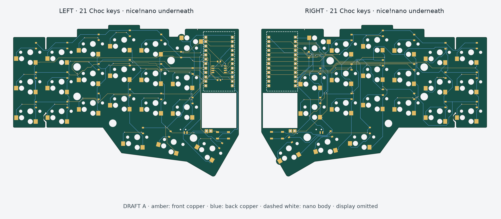

# zenR4-pcb

A custom wireless, Choc-spaced replacement PCB prototype for a **42-key Corne-ish Zen V2** metal case. Two nice!nano v2 controllers, the same tested matrix pinout on both halves, and left-only QSPI flash for Javelin.

**DRAFT A: routed, electrically checked, unbuilt.** Both halves passed native KiCad ERC, DRC, unconnected checks and schematic parity with zero issues. Physical fit and assembly are still open. The optional right nice!view footprint is absent.

## Read first

- [ChatGPT handoff — full context, pin tables, decisions and next steps](docs/CHATGPT-HANDOFF.md)
- [Start a new ChatGPT conversation](docs/START-HERE.md)
- [Download the ChatGPT upload ZIP](docs/zenR4-pcb-chatgpt-handoff.zip) — 2.4 MiB, including seven PNGs and native schematic/board files
- [Layout and mechanical notes](r4-layout/README.md)
- [Final check snapshot and hashes](r4-layout/checks/validation.json)
- [Annotated images](docs/images/) and [direct schematic exports](docs/schematics/)

Open `r4-layout/zen-r4-left.kicad_pro` or `r4-layout/zen-r4-right.kicad_pro` in KiCad 10. Project-local symbol and footprint libraries are included. Run `sh r4-layout/run-checks.sh` to repeat the native checks; set `KICAD_CLI` for a different installation.

## Next steps

1. Resolve the new rear USB opening at the nano location; it is offset from the archived original ports.
2. Use the included actual-size paper templates and 3D-printable dummy boards to check the **new** outline, thumb/boss geometry and controller/base stack.
3. Finalize nano soldering, battery protection/retention, power/reset access, exact BOM and assembly method; review QSPI/radio/power layout.
4. Decide whether the first pair keeps the display omitted or needs a separate mechanically proven right-display revision.
5. Freeze the reviewed prototype, generate/review manufacturing outputs, order a small prototype run, then bring up and test the real boards.

The user's existing Typeractive socket and underside-nano dry fits are accepted. They do not certify this new USB position or our modified perimeter. No production Gerbers, order or PCBA quote has been released.

## Repository scope

`r4-layout/` is the current source of truth. `zen-r4-review/` is earlier electrical/firmware context. Experimental scripts in `analysis-tools/` can overwrite finished geometry/routing; read [the tooling notes](analysis-tools/README.md) before running them. The working keyboard firmware was not modified or flashed.

This repository is private by default and contains restricted reference CAD. See [attribution and third-party notices](ATTRIBUTION.md) before any future public release.
