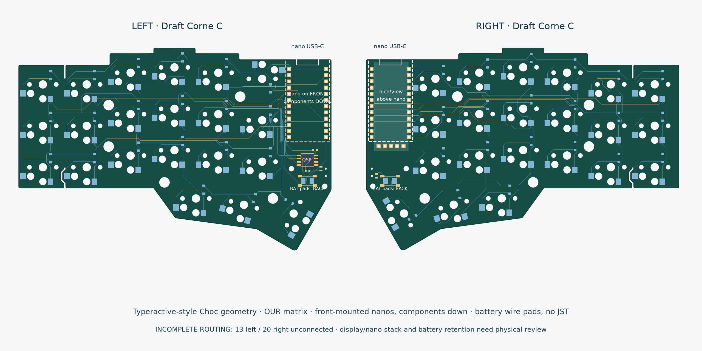
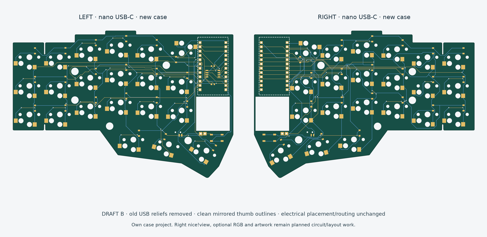

# Steno Squid QSPI expansion module

Current hardware work is the [Steno Squid eight-contact daughterboard](projects/steno-squid/README.md) for the Boardsource Wireless Corne SMT. Its first electrical proposal is available in native KiCad. Connector dimensions, supply verification and exact flash package are the next design inputs.

## Completed Draft-Corne routing reference

# Draft-Corne: Choc Corne with left flash / right nice!view

**[Draft C files and status](projects/choc-corne-flash/draft-c/README.md)** · [ChatGPT handoff](docs/CHATGPT-HANDOFF.md) · [Download packet](docs/draft-corne.zip)

Both nice!nanos mount on the front, components down. Our tested matrix and left QSPI are retained; the right has a real nice!view interface. Battery connections use back-side solder pads. Both halves are routed and pass KiCad ERC, DRC, and schematic parity checks. Physical assembly still needs verification.

Repository remains private; preserve [source attribution](ATTRIBUTION.md). The older Draft B information below is historical.

---

# zenR4-pcb — Nano Independent

Historical Draft B direction: our own 42-key Choc nice!nano keyboard and case, inspired by Zen geometry. The owner is pursuing an original spare PCB for their Zen; integrated replacement development is set aside.

## Historical draft: B

- Old rear USB reliefs removed; USB-C comes from the nice!nano.
- Thumb clearance bubble replaced by a smooth, mirrored contour.
- All electrical objects and switch centers preserved from Draft A.
- Both halves pass native ERC, DRC, unconnected and schematic parity checks with zero issues.

**[Open Draft B](projects/nano-independent/draft-b/README.md)** · [Thumb before/after](projects/nano-independent/draft-b/thumb-before-after.png) · [Current ChatGPT handoff](docs/CHATGPT-HANDOFF.md) · [Download Draft B packet](docs/nano-independent-draft-b.zip)

Right nice!view, optional flash population, optional RGB and squid art remain the target. Their new display/RGB circuits and the new case are not implemented by this outline-only revision. See [project direction](projects/nano-independent/README.md).

Open the `zen-r4-left.kicad_pro` / `zen-r4-right.kicad_pro` under `projects/nano-independent/draft-b/`. `r4-layout/` is the unchanged Draft A baseline, also tagged `draft-a-baseline`; its old case-fit notes and upload ZIP are historical. Experimental generators can overwrite finished work.

For tomorrow's ChatGPT discussion, use [START-HERE](docs/START-HERE.md). Private GitHub links may require your signed-in account; upload the handoff/images if ChatGPT cannot read the repo.

Repository visibility remains private. Restricted source CAD and derived files retain their attribution and source restrictions; see [ATTRIBUTION](ATTRIBUTION.md). No hardware/fabrication order or production readiness is claimed.
