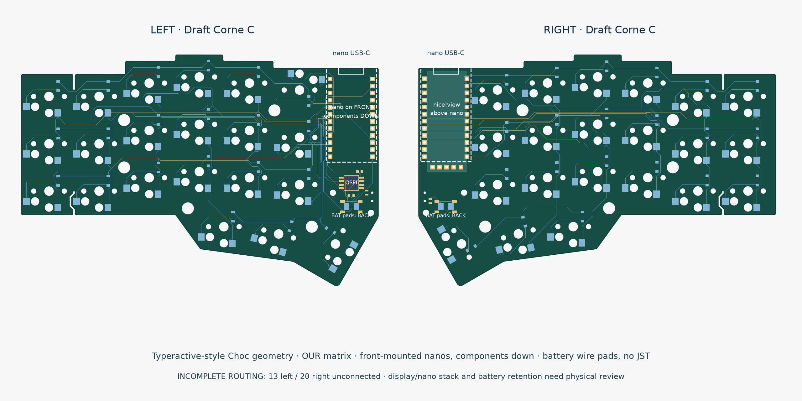

# Draft-Corne (Draft C)

42-key Typeractive-style Choc-spaced Corne with our tested matrix, left QSPI flash and right nice!view. This is a new electrical/placement draft, not a manufacturing release. The geometry was reconstructed from a public 3D model; it is not Typeractive's original PCB source. See the reference folder and root ATTRIBUTION.md.

Open `draft-corne-left.kicad_pro` or `draft-corne-right.kicad_pro` beside their matching schematic and PCB. Keep the local symbol library, footprint directory and library tables with the files.

## Assembly direction

- Both nice!nanos mount on the **front**, with **components facing down** toward the carrier PCB, as explicitly requested. Both have the same physical pin-bank orientation: top view, USB up, carrier U1 pad 1 is on the right and pad 13 on the left.
- Choc sockets and diodes are on the back. The left top-row innermost socket SW6 is rotated 180 degrees and D6 moved to avoid mounting-hole/socket clearances; its switch center and electrical assignment are unchanged.
- Left flash U2 and local 100 nF C1 / 10 kΩ R1 occupy the former JST electronics region, on the front. Candidate flash is W25Q128JVSIQ, **208-mil SOIC**, not the narrower SOIC package.
- Battery J1 is a pair of **back-side solder pads**: 1 BAT+, 2 GND. No JST. Plan strain relief and insulated battery retention in the new enclosure. Reset is on the opposite face in this area.
- Right J2 supplies a nice!view above the nano. The footprint establishes the interface, not a proven header height or display mount. Review the complete stack and solder access before buying headers.
- Power/reset footprints are candidates (MSK12C02 / TL3342), pending exact purchased-part drawing checks. The battery switch disconnects the cell; USB can still power the nano. Charging while switched off is not promised.

## Pin plan

Both halves retain ROW0–3 = D8, D9, D21, D20; COL0–5 outside→seam = D19, D18, D15, D14, D0, D1. Col2row diodes; right firmware reverses column scan with global offset 6. This is **our matrix**, not stock Typeractive D4–D7 rows.

Left flash CS#/CLK/IO0/IO1/IO2/IO3 = D2/D4/D5/D6/D7/D3, plus switched 3V3 and GND. The nano controls the switched rail internally using P0.13; that GPIO is not a carrier edge pad.

Right nice!view J2, viewed from the front, left→right:

| Pad | Signal | nice!nano |
|---|---|---|
| 1 | MOSI | D2 / P0.17 |
| 2 | SCK | D3 / P0.20 |
| 3 | VCC | switched 3V3 |
| 4 | GND | GND |
| 5 | CS, active high | D4 / P0.22 |

The custom right CS is D4; the existing Ultralight's D0 CS cannot be copied because D0 is one of our matrix columns. Working hardware/firmware has not been altered.

## Checks and remaining work

See `validation.json` for the exact current checks and hashes. Before routing, both native schematics passed ERC and both placements had zero reported DRC violations or schematic parity issues, with 84 left / 77 right unconnected items. These are placement checks, not a completed PCB. KiCad's configured ignored-check categories are recorded in the native reports; no implication of all possible checks is intended.

The first imported routing pass has **13 left / 20 right unconnected items**, with **0 reported DRC violations, 0 schematic parity issues and 0 ERC violations on each half**. Routing is experimental until the current DRC/unconnected counts are zero and reviewed. Next: finish traces, review antenna clearance and display/nano/header stack, confirm exact switch/flash/socket footprints against parts, select battery and retention, then run final ERC/DRC/parity and prototype. No fabrication files/order are provided. RGB, artwork, integrated SoC and Zen-shell accommodation remain deferred. Drafts A/B remain historical.

Official display references: [pinout](https://nicekeyboards.com/docs/nice-view/pinout-schematic/) and [dimensions](https://nicekeyboards.com/static/2f2592ff1ff8021932814b20cb76e3c4/a6d36/niceview_dimensions.png).
