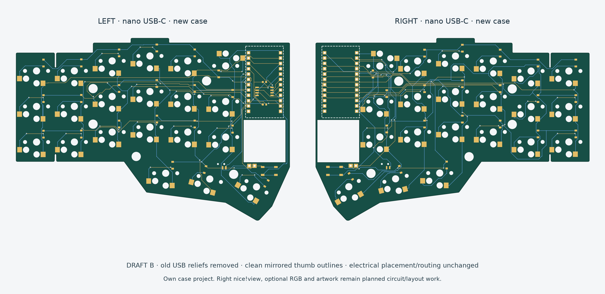
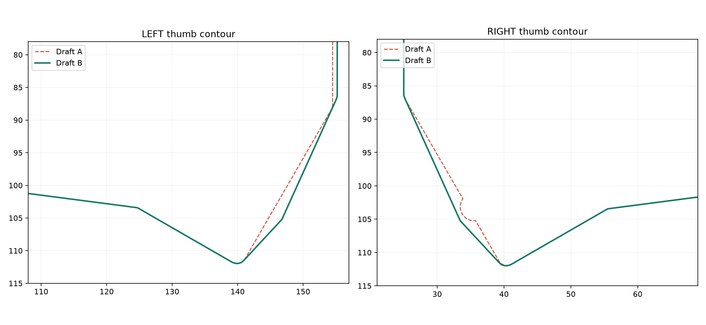

# Nano Independent — Draft B

**Outer-outline revision of the checked Draft A nice!nano carriers. Own case project; not intended as a replacement inside the Zen metal shell.**

## Changes requested

1. **Old USB cutouts removed.** The old ~9 mm rear reliefs came from the archived original PCB's USB position. We use the nano's USB-C, so the rear electronics edge is now flat and mirrored. The new case's opening and plug clearance must be designed around the module connector; there is no standalone carrier USB connector here.
2. **Thumb bump corrected.** Draft A's right innermost socket pad SW19 had a local circular board extension added for copper-to-edge clearance. It was a one-sided clearance patch, not a different thumb-key count or intentional ergonomic feature. Draft B uses a continuous chamfer enclosing that pad and mirrors the complete outer contour onto both halves. Pad clearance remains checked.

## Preserved

Every footprint, pad, net, track, via and rule area is byte-for-byte unchanged from Draft A's electrical payload. Both schematics are copied unchanged, as are the four battery-opening edges per half. GPIO assignments, matrix scan convention, QSPI power/wiring and module placement are unchanged. The only other board-file edit is the drawing-note revision label.

The outlines are mathematically mirrored after a reflection/translation fitted to the main grids; the measured outline Hausdorff difference is **0 mm**. The inherited switch centers themselves were not moved. Their archived-CAD registration is not perfectly mirrored; main-grid left/right differences are below 0.10 mm. Do not mirror complete Choc socket copper blindly: the physical socket package is asymmetric.

The revised outline adds approximately 115.6 mm² (left) / 112.0 mm² (right), mostly filling rear reliefs and blending the thumb cap. It removes no meaningful board area around existing copper. Old Zen mounting holes remain as references for now, not a mandatory new-case design.

## Checks

Both halves: **zero ERC violations, zero DRC violations, zero unconnected items and zero schematic parity issues.** Reports and exact electrical-payload comparison are under `checks/`. `geometry-audit.json` records the mirror test; `validation.json` records final file hashes. These checks do not prove assembly, radio/signal behavior or the new case.

Open `zen-r4-left.kicad_pro` or `zen-r4-right.kicad_pro` in this folder. They share the retained `ZenR4` footprint library via the relative `../../../r4-layout/footprints/` path. Do not open `r4-layout/` expecting these new edges; that folder is the unchanged baseline.

`mechanical/` includes 1:1 paper templates with a 25 mm calibration bar and watertight 1.6 mm bare-PCB fit STLs. Print at 100% actual size. These are new-case/board studies; the old Zen base plates are not updated to fit Draft B.

## Feature status and next work

Actual circuitry here still has left flash, nice!nano controllers and no right display footprint. Right nice!view, optional RGB, flash-DNP release builds and squid artwork remain planned. This revision deliberately does not invent a completed display/RGB design while changing the outline.

Next: review this contour; establish the new controller/display/battery/case stack; choose module mounting and new mounts; then add the right nice!view interface and separate RGB power domain in a new circuit revision. Keep native ERC/DRC/parity and physical assembly review after changes.
